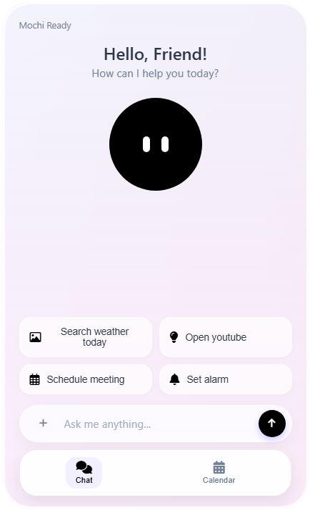

# Mochi - A Cute Friend Assistant.
a lightweight intent classification(text classification) model which does tool calling and is a cute assistant.
the project is inspired by Google Assistant.

---

## Key Features

- **Real-Time Tool calling** it can call it's tool very fast.
- **Calender** it has it's own calender which it can use to schedule user's meeting or reminders.
- **App open** it can open apps.
- **Google search** it can use your prompt and does google search.
- **Native runtime** the model runs natively on the browser ,it is lightweight.

---

## Tech Stack

- **HTML5**
- **CSS3**
- **JAVASCRIPT**
- **PYTHON** - To make the model and extract the weights.
---
## Train Model On Your Own 
- Training folder contains the instruction on how to train the model along with the Training.py script.

## Landing Page
- **https://grafikeaserc-design.github.io/Mochi/landing-page/index.html**
## App
- **https://grafikeaserc-design.github.io/Mochi/**

---
>[!NOTE]
>License
>
>The source code of this project is licensed under the MIT License.
>
>All logos, branding, screenshots, and visual assets are © Rudranil / Mochi. They are all rights reserved and cannot be used for commercial purposes without explicit permission.

